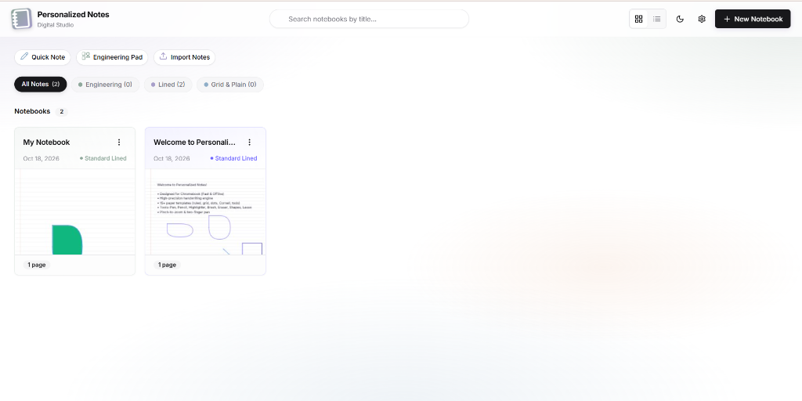
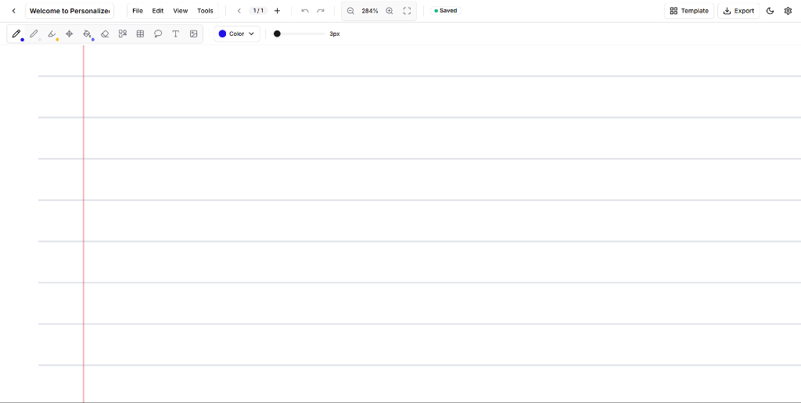

# Personalized Notes

[](LICENSE)
[](src/engine/ShapeRecognition.test.js)
[](https://vitejs.dev/)
[](src/storage/Database.js)
[](public/_headers)

A high-performance, offline-first digital notebook designed for handwriting, sketching, and structured note-taking. Built with a multi-layer canvas architecture and intelligent shape recognition.

## Live Deployments

- Production Web App: [https://personallised-notes.vercel.app](https://personallised-notes.vercel.app)
- GitHub Pages Mirror: [https://anandakrishnano-bit.github.io/personallised-notes/](https://anandakrishnano-bit.github.io/personallised-notes/)

## Preview

| Home Dashboard | Canvas Editor |
| :---: | :---: |
|  |  |

## Features

### Multi-Layer Canvas Architecture
- Specialized layers for Background, Content, Active Ink, and UI overlays.
- Low-latency response utilizing hardware-accelerated 2D contexts.
- Calibrated coordinate mapping for touch, stylus, and desktop mouse input.
- Automatic scaling for high-density displays (DPR).

### Natural Handwriting and Drawing Engine
- Velocity-sensitive stroke dynamics with smooth width interpolation.
- Hardware stylus pressure and tilt support.
- Sub-frame point capture for fluid line rendering.
- Multiple drawing instruments: Calligraphic Pen, Textured Graphite Pencil, Translucent Highlighter, and Precision Eraser.

### Real-Time Shape Recognition
- Geometric engine running locally in real-time.
- Automatically recognizes circles, ellipses, rectangles, triangles, polygons, straight lines, and arrows.

### Paper Templates and Formats
- Standard paper formats: A4, A5, US Letter, and Infinite Canvas.
- Extensive template catalog: Studio White, Warm Cream, Engineering Pad, Ruled, Grid, Isometric, Cornell Notes, Dotted, and Music Staff.
- Dark mode support with automatic contrast adjustment.

### Document Elements
- Image insertion via drag-and-drop or clipboard paste.
- Movable text annotations with custom styling.
- Tabular data grids with expandable rows and columns.
- Lasso selection for moving, organizing, and clearing content.

### Privacy and Local Storage
- Fully client-side execution. Notes are stored exclusively in the browser using IndexedDB.
- Zero analytics, trackers, or external API dependencies.
- Strict Content Security Policy and HTTP security headers.

## Technology Stack

- Core: Modern JavaScript (ES Modules), Vanilla CSS, HTML5 Canvas
- Persistence: IndexedDB
- Build Tool: Vite
- Test Runner: Vitest

## Getting Started

### Prerequisites
- Node.js (v18.0.0 or higher)
- npm (v9.0.0 or higher)

### Installation
```bash
git clone https://github.com/anandakrishnano-bit/personallised-notes.git
cd personallised-notes
npm install
```

### Development
```bash
npm run dev
```

### Running Tests
```bash
npm test
```

### Production Build
```bash
npm run build
```

## Security

- All notes remain private to the user's browser storage.
- External connections are restricted by a strict Content Security Policy.

## License

This project is licensed under the MIT License. See [LICENSE](LICENSE) for details.
