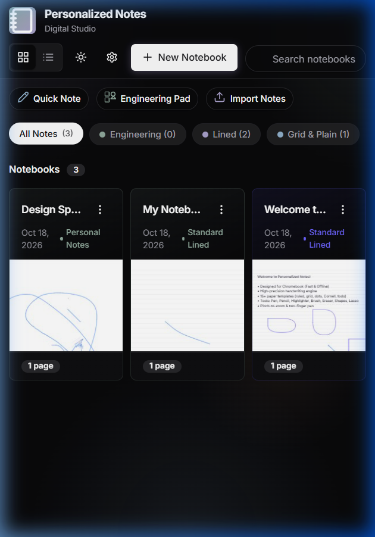

# Personalized Notes

[](LICENSE)
[](src/engine/ShapeRecognition.test.js)
[](https://vitejs.dev/)
[](src/storage/Database.js)
[](public/_headers)

A high-performance, offline-first digital notebook designed for natural handwriting, sketching, and structured note-taking. Built with a multi-layer HTML5 Canvas architecture, real-time geometric shape recognition, and boundary-aware area flood fill.

## Live Deployments

- Production Web App: [https://personallised-notes.vercel.app](https://personallised-notes.vercel.app)
- GitHub Pages Mirror: [https://anandakrishnano-bit.github.io/personallised-notes/](https://anandakrishnano-bit.github.io/personallised-notes/)

## Preview

| Home Dashboard | Canvas Editor & Flood Fill |
| :---: | :---: |
|  |  |

## Key Features

### 1. Multi-Layer Canvas Architecture
- Dedicated canvas layers for Background, Content, Active Ink, and UI overlays.
- Active drawing layer uses compositor-desynchronized 2D contexts for low latency stroke response.
- Pixel-perfect coordinate mapping calibrated for touch, stylus, and desktop mouse inputs.
- Device Pixel Ratio (DPR) automatic scaling for high-density displays.

### 2. Natural Handwriting and Stroke Engine
- Velocity-dependent stroke dynamics with dynamic width interpolation.
- Hardware stylus pressure and tilt support with exponential smoothing filters.
- Sub-frame coalesced pointer event capture for high-frequency stroke reproduction.
- Multi-tool support: Calligraphic Pen, Textured Graphite Pencil, Translucent Highlighter, Precision Eraser, and Area Fill.

### 3. Real-Time Intelligent Shape Recognition
- Hold-to-convert geometric engine running locally in under 0.2 milliseconds.
- Detects circles, ellipses, rectangles, triangles, diamonds, stars, straight lines, arrows, and arbitrary regular polygons.
- Non-destructive two-stage undo: undoing once restores the original freehand stroke, second undo removes it.

### 4. Boundary-Aware Area Flood Fill
- Scanline flood fill algorithm detects and fills closed regions between hand-drawn lines, pen strokes, or overlapping shapes.
- Automatic corner gap sealing with 1-pixel bleed dilation to tuck fills cleanly under boundary borders without white fringes.
- Leakage detection prevents unintentional whole-page fills if lines are not fully connected.
- Full undo/redo integration with persistent serialization.

### 5. Paper Templates and Formats
- Multiple page formats: A4 Portrait, A4 Landscape, A5 Portrait, A5 Landscape, US Letter, and Infinite Canvas.
- Diverse paper styles: Studio White, Warm Cream, Engineering Pad (Green/Sepia), Ruled (Narrow/Standard/Wide), Grid (Small/Medium/Large), Isometric Grid, Cornell Notes, Dotted, and Music Staff.
- Dark mode support with automatic paper contrast adaptation.

### 6. Interactive Document Elements
- Rich image insertion via drag-and-drop or clipboard paste.
- Movable text annotations with customizable font sizing and colors.
- Interactive data tables with column/row expansion and cell editing.
- Lasso selection tool for translating, repositioning, and deleting content.

### 7. Privacy and Security
- 100% client-side execution. All notebooks, pages, and strokes are stored exclusively in the browser's IndexedDB.
- Zero tracking scripts, zero external analytics, and zero telemetry.
- No external server dependencies or API keys required.
- Hardened HTTP security headers: Content Security Policy, Frame Options DENY, nosniff, and restricted Permissions Policy.

## Technology Stack

- Language: Modern JavaScript (ES Modules)
- Styling: Custom Vanilla CSS (Design tokens, dark/light themes, responsive layout)
- Rendering Engine: HTML5 Canvas 2D API
- Persistence: IndexedDB via idb
- Build System: Vite
- Testing Suite: Vitest

## Getting Started

### Prerequisites
- Node.js (v18.0.0 or higher)
- npm (v9.0.0 or higher)

### Installation
1. Clone the repository:
   ```bash
   git clone https://github.com/anandakrishnano-bit/personallised-notes.git
   cd personallised-notes
   ```

2. Install dependencies:
   ```bash
   npm install
   ```

3. Launch development server:
   ```bash
   npm run dev
   ```
   Open http://localhost:3000 in your browser.

### Running Automated Tests
Execute the unit and regression test suite:
```bash
npm test
```

### Production Build
Generate an optimized production bundle:
```bash
npm run build
```
The compiled static assets are output to the `dist/` directory.

### Preview Production Build
Serve the production bundle locally:
```bash
npm run preview
```

## Project Structure

```
├── .github/
│   └── workflows/
│       └── deploy.yml         # GitHub Actions 24/7 automated GitHub Pages deployment
├── assets/
│   └── screenshots/           # Application screenshots for repository presentation
├── public/                    # Static assets, PWA manifest, security headers
│   ├── _headers               # Security response headers (CSP, HSTS, frame guards)
│   ├── _redirects             # Single Page Application routing configuration
│   └── icon.svg               # Application vector icon
├── src/
│   ├── engine/                # Canvas rendering and event management
│   │   ├── CanvasManager.js   # Multi-layer canvas orchestration and viewport transforms
│   │   ├── InputHandler.js    # Pointer event processing and coordinate mapping
│   │   ├── ShapeRecognizer.js # Geometric analysis and shape fitting algorithms
│   │   └── StrokeRenderer.js  # Spline interpolation, calligraphic pen width, and fills
│   ├── history/               # Undo and redo state management
│   │   └── HistoryManager.js  # Command pattern action stack
│   ├── models/                # Data models
│   │   ├── Notebook.js        # Notebook collection and pastel themes
│   │   ├── Page.js            # Page dimensions, templates, and stroke containers
│   │   └── Stroke.js          # Stroke coordinates, styles, and fill data
│   ├── storage/               # Database abstraction
│   │   └── Database.js        # IndexedDB operations
│   ├── templates/             # Paper background generators
│   │   └── TemplateRenderer.js# Ruled, grid, dotted, and engineering patterns
│   ├── tools/                 # Canvas interaction tools
│   │   ├── BaseTool.js        # Tool interface
│   │   ├── PenTool.js         # Handwriting with hold-to-convert recognition
│   │   ├── PencilTool.js      # Textured graphite pencil
│   │   ├── HighlighterTool.js # Translucent highlighter
│   │   ├── FillTool.js        # Boundary-aware scanline flood fill
│   │   ├── EraserTool.js      # Stroke and area eraser
│   │   ├── ShapeTool.js       # Manual geometric vector shapes
│   │   ├── SelectTool.js      # Lasso selection and transformation
│   │   ├── TextTool.js        # Draggable text annotations
│   │   └── TableTool.js       # Structured tabular grids
│   ├── ui/                    # User interface components
│   │   ├── LibraryView.js     # Home dashboard, notebook grid, search, and filters
│   │   ├── Toolbar.js         # Top navigation and tool properties dock
│   │   ├── ColorPicker.js     # Color palette selection
│   │   ├── Dialog.js          # Modal confirmation dialogues
│   │   └── Toast.js           # Notification system
│   ├── styles/                # Application styles
│   │   └── main.css           # Design tokens, themes, layout, and component styles
│   ├── App.js                 # Application controller and view coordinator
│   └── main.js                # Application entrypoint
├── CONTRIBUTING.md            # Guidelines for project contributions
├── LICENSE                    # MIT open-source license
├── SECURITY.md                # Client-side privacy and security disclosures
├── index.html                 # Main HTML entrypoint
├── vercel.json                # Vercel deployment headers and routing configuration
├── package.json               # Project manifest, scripts, and dependencies
└── vitest.config.js           # Test runner configuration
```

## Security and Privacy Guidelines

- No sensitive personal information, credentials, or API keys are stored in this repository.
- All drawing data and notes are persisted exclusively on the client machine using browser storage.
- External connections are constrained by the Content Security Policy to prevent unauthorized script injection and data transmission.

## License

This project is licensed under the MIT License. See [LICENSE](LICENSE) for details.
